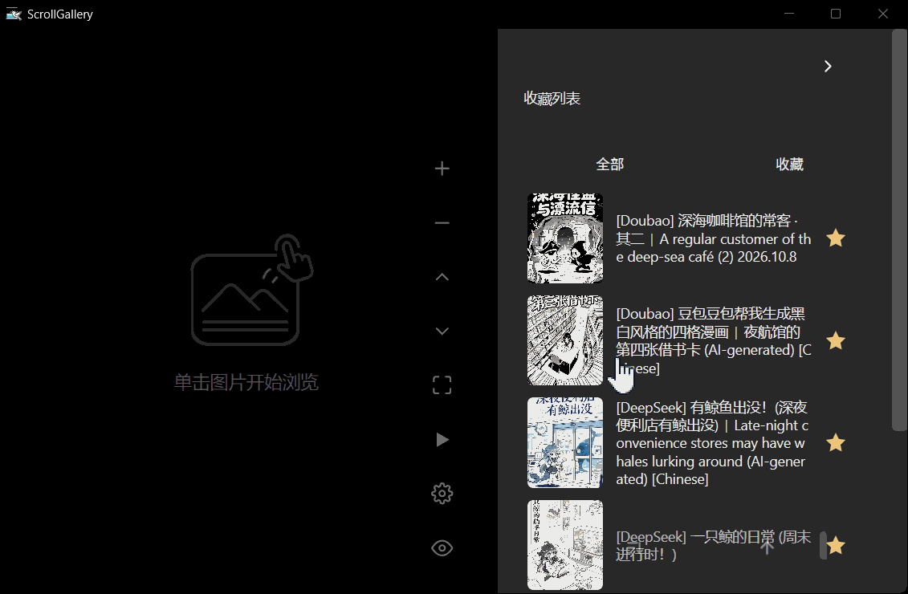
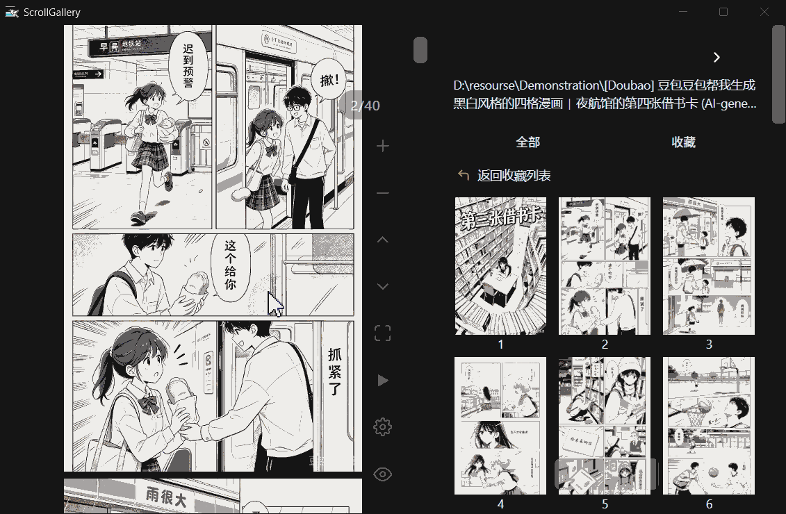
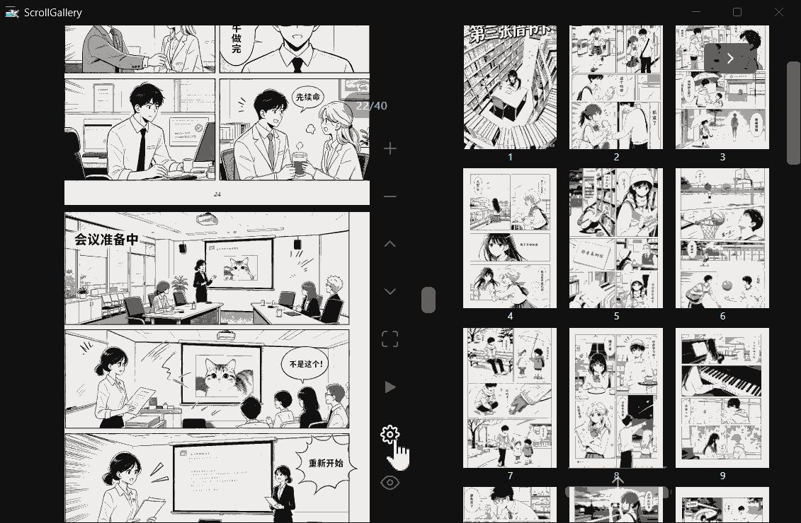
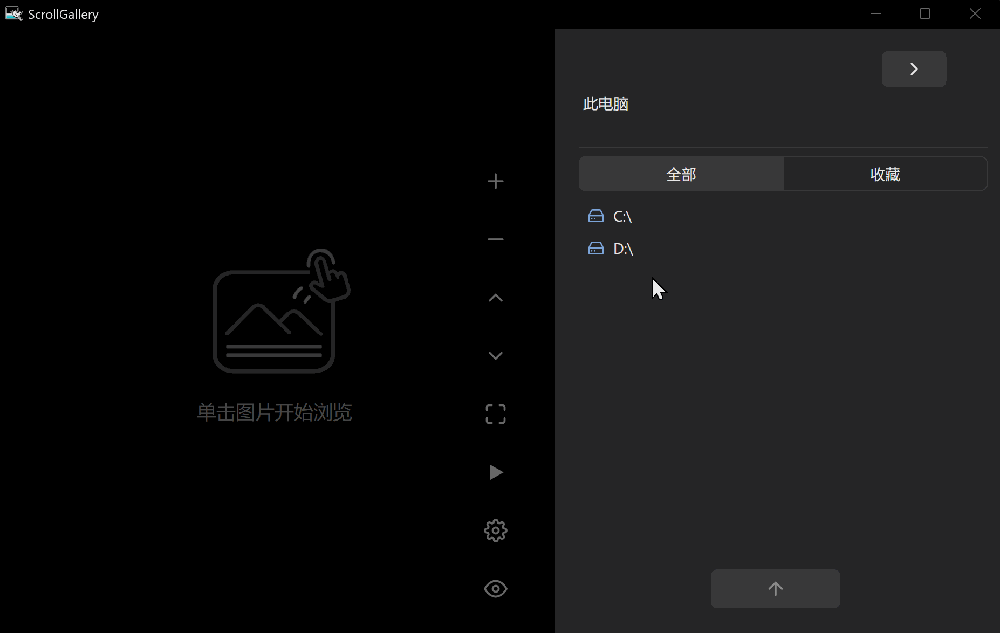
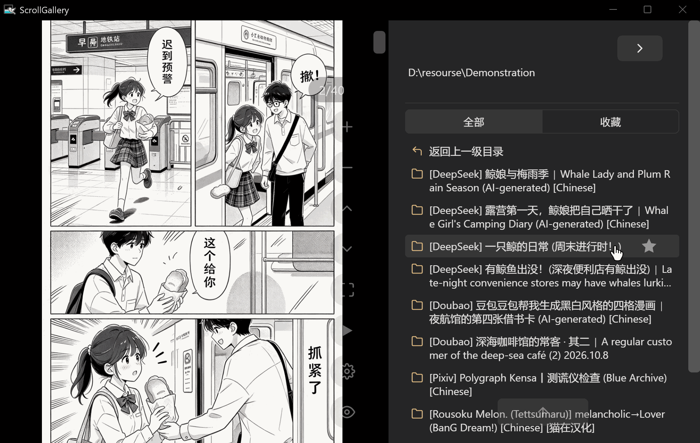
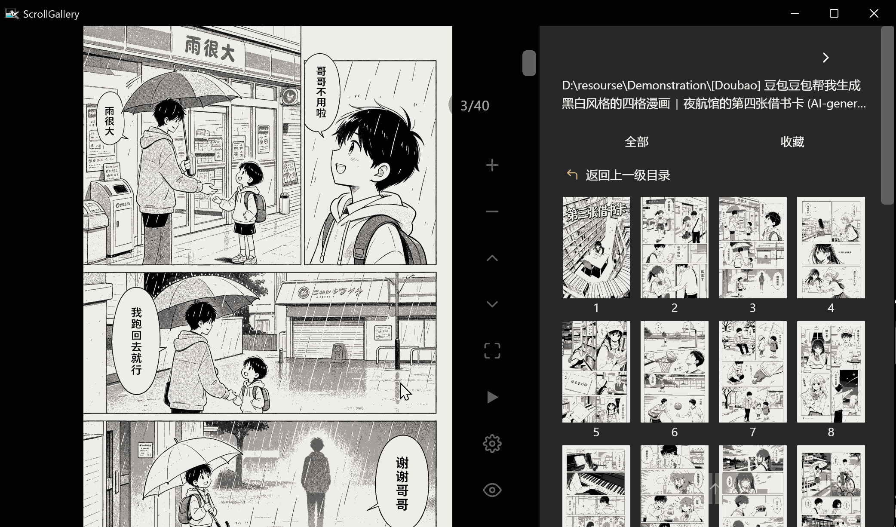
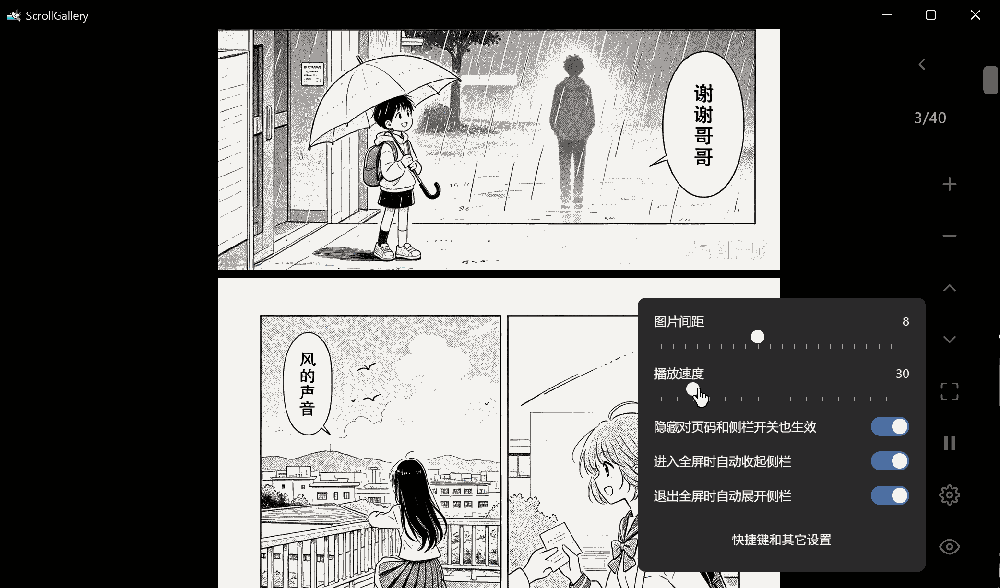
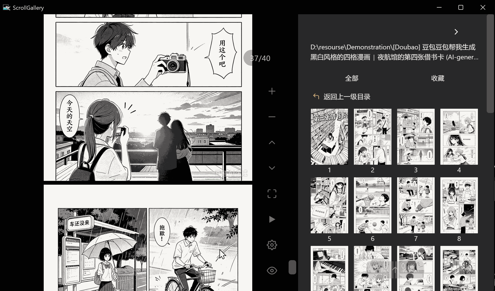

# ScrollGallery

**在 Windows 上，像读条漫一样浏览本地漫画与图集。**

**>>&nbsp;&nbsp;&nbsp;&nbsp;[功能介绍](#功能介绍)&nbsp;&nbsp;&nbsp;&nbsp;|&nbsp;&nbsp;&nbsp;&nbsp;[下载与使用](#下载与使用)&nbsp;&nbsp;&nbsp;&nbsp;<<**

<table>
<tr>
<td width="33%"></td>
<td width="33%"></td>
<td width="33%"></td>
</tr>
</table>

---

## 功能介绍

### 1. 选择目录
   
侧边栏是一个简易目录浏览器，目录中若有图片则会以缩略图列表的形式展示，点击缩略图即可进行查看。

点击目录右侧的星星图标 ⭐ 收藏目录，被收藏的目录在收藏列表可见，并且会以该目录中第一张图片作为封面。

<table>
<tr>
<td width="50%"></td>
<td width="50%"></td>
</tr>
</table>

- 预览图片的排列顺序与 Windows 文件资源管理器中文件的排列顺序完全一致，并会根据排序将文件名自动映射为自然数。

### 2. 浏览图片

图片区域本身就是操作区，以下为默认操作：

- **点击**：点图片左侧 / 右侧翻页，点下方弹出进度条，双击中间进入全屏，右键开关侧栏。
- **按住拖拽**：左键上下拖 = 缩放，右键任意拖 = 平移大图 / 滚动页面。
- **键盘**：`←` `→` 翻页、`↑` `↓` 滚动、`,` `.` 缩放、`Enter` 全屏、`Space` 暂停/播放 …… ；
  - 缩放、翻页、平移、滚动均支持长按连发。

以上每一项——单击区域、拖拽手势、键盘按键——都可以在设置中逐个改键或禁用。

<table>
<tr>
<td width="50%"></td>
<td width="50%"></td>
</tr>
<tr>
<td width="50%"></td>
<td width="50%"></td>
</tr>
</table>

---

## 下载与使用

前往 [Releases 页面](https://github.com/redateZao/ScrollGallery/releases/latest) 下载压缩包，**解压后**双击 ScrollGallery.exe 运行。

- 建议在 Windows 11 上运行（依赖系统内置的 WebView2）。
- 支持的图片格式：JPG、JPEG、PNG、WebP、GIF（目录中的 BMP、TIFF 等其它格式不会显示）。
- 使用时，请确保 ScrollGallery.exe 和 `_internal` 在同一个目录下。
- 首次运行后，程序会在自身所在目录自动生成 `.cache` 文件夹，包含：
    > - `thumbs` ：缩略图缓存（ 上限 100MB，约能缓存 1800 张图片，超过阈值会自动清理 ）。
    > - `webview` ：用户数据目录（ 快捷键设置、收藏等 ）。
    > - `window.json` ：窗口几何记忆文件（ 记录窗口的大小和位置 ）。
    > &nbsp;
    >  
    > 除了上述内容以外，ScrollGallery 不会在任何位置生成多余的文件。 
- 卸载时，直接删除整个文件夹即可，无残留。

---

> [!NOTE]
> 本项目的代码在开发过程中使用了 AI 辅助（Qwen3.8-Flash），所有生成内容均经过人工审查和测试。
> 本页界面截图与录屏均为软件实拍；演示浏览的图片素材由豆包 AI 生成，仅用于功能展示。
> 如认为其中内容侵犯了您的权利，请提交 [issue](https://github.com/redateZao/ScrollGallery/issues) 联系删除。

